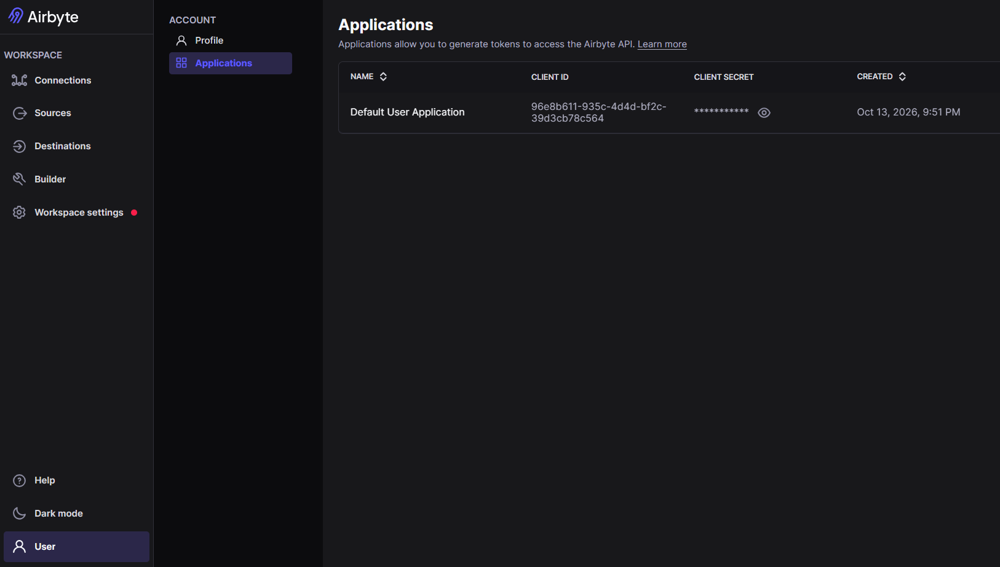
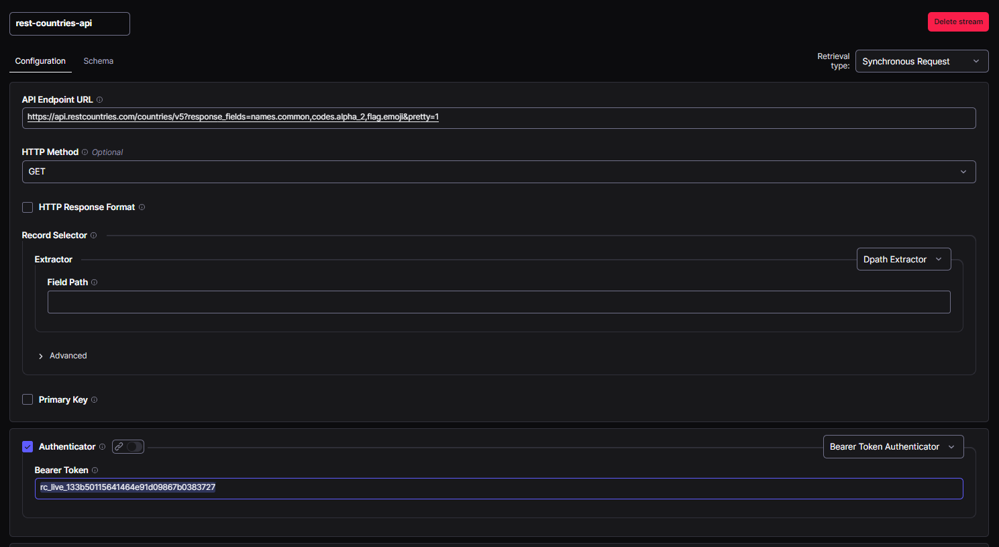

# Aula 1 — Atividades Práticas
## Engenharia de Dados com Ferramentas Open Source

**Curso:** Engenharia de Dados com Ferramentas Open Source
**Aula:** 1 — Fundamentos da Engenharia de Dados e Arquitetura de Repositórios
**Duração das Atividades:** 2 horas
**Pré-requisitos:** Conhecimento básico de Python e linha de comando (terminal)

---

## Visão Geral das Atividades

As três atividades práticas desta aula formam uma sequência progressiva e interdependente. A **Atividade 1** prepara o ambiente completo que será utilizado ao longo de todo o curso. A **Atividade 2** coloca esse ambiente em operação, subindo o serviço de armazenamento de objetos MinIO que simulará o Data Lake local. A **Atividade 3** introduz os formatos de arquivo fundamentais para engenharia de dados, demonstrando na prática por que o formato Parquet é o padrão da indústria para repositórios analíticos.

| Atividade | Tema | Duração Estimada | Ferramentas |
|---|---|---|---|
| 1 | Configuração do Ambiente de Desenvolvimento | 40 min | Docker, Docker Compose, Python 3.11+, Git |
| 2 | Subida e Exploração do MinIO (Data Lake Local) | 30 min | Docker Compose, MinIO, Python (`boto3`) |
| 3 | Comparação de Formatos de Arquivo: CSV, JSON e Parquet | 50 min | Python, Pandas, PyArrow, Jupyter Notebook |

---

## Atividade 1 — Configuração do Ambiente de Desenvolvimento

### Objetivo

Preparar o ambiente de desenvolvimento local que será utilizado ao longo de todo o curso, garantindo que todas as ferramentas necessárias estejam instaladas, configuradas e funcionando corretamente. Um ambiente bem configurado é o alicerce de qualquer projeto de engenharia de dados.

### Contexto

Diferentemente de ambientes de produção em nuvem, o ambiente local do curso utiliza **Docker** e **Docker Compose** para isolar e orquestrar os serviços necessários (MinIO, bancos de dados, ferramentas de processamento). Essa abordagem garante reprodutibilidade: o ambiente funcionará da mesma forma em qualquer máquina, independentemente do sistema operacional do aluno. Ao final, os arquivos produzidos e as imagens poderão ser utilizados como base para ambientes de produção com o uso de Kubernetes.

### Pré-requisitos de Hardware

O ambiente mínimo recomendado para executar todas as ferramentas do curso é de 8 GB de RAM e 20 GB de espaço em disco disponível. Ambientes com 16 GB de RAM proporcionarão uma experiência mais fluida, especialmente nas aulas de Apache Spark.

---

### Passo 1 — Instalação do Docker e Docker Compose

O Docker é a plataforma de conteinerização que permite executar serviços complexos como MinIO e Airflow com um único comando, sem necessidade de instalação manual de dependências.


Instale o [Docker Desktop para Windows](https://www.docker.com/products/docker-desktop/), que requer o WSL 2 (Windows Subsystem for Linux) habilitado. Siga as instruções do instalador.

**Verificação:**

```cmd
# Verificar a versão do Docker
docker --version
# Saída esperada: Docker version 24.x.x, build ...

# Verificar o Docker Compose
docker compose version
# Saída esperada: Docker Compose version v2.x.x
```

---

### Passo 2 — Instalação do Python 3.11+ e Gerenciador de Pacotes

O Python é a linguagem principal do curso. Recomenda-se fortemente o uso de ambientes virtuais para isolar as dependências de cada projeto.

```cmd
python --version
```

### Se não estiver instalado, será oferecida a opção de instalar da Microsoft Store que é a forma mais simples de efetuar essa instalação.

---

### Passo 3 — Instalação do Git e Configuração Inicial

O Git será utilizado para versionar todos os scripts e configurações desenvolvidos ao longo do curso.

Faça o download do instalador a partir do seguinte link:  https://git-scm.com/install/windows

---

---

### Passo 4 — Criação da Estrutura de Diretórios do Projeto

Toda a estrutura do curso seguirá uma organização padronizada que reflete a arquitetura Medallion. Execute os comandos abaixo para criar o projeto base:

```cmd
PS C:\ mkdir ~/engenharia-dados-2026-2
PS C:\ cd ~/engenharia-dados-2026-2
PS C:\Users\mamaz\engenharia-dados-2026-2> mkdir notebooks, scripts, dbt_project, airflow/dags, docker, data/bronze, data/silver, data/gold
PS C:\Users\mamaz\engenharia-dados-2026-2> echo "" > notebooks/README.md
PS C:\Users\mamaz\engenharia-dados-2026-2> echo "" > scripts/README.md
PS C:\Users\mamaz\engenharia-dados-2026-2> echo "" > dbt_project/README.md
PS C:\Users\mamaz\engenharia-dados-2026-2> echo "" > airflow/dags/README.md
PS C:\Users\mamaz\engenharia-dados-2026-2> echo "" > docker/README.md
PS C:\Users\mamaz\engenharia-dados-2026-2> echo "" > data/bronze/README.md
PS C:\Users\mamaz\engenharia-dados-2026-2> echo "" > data/silver/README.md
PS C:\Users\mamaz\engenharia-dados-2026-2> echo "" > data/gold/README.md
PS C:\Users\mamaz\engenharia-dados-2026-2> python -m venv .venv
PS C:\Users\mamaz\engenharia-dados-2026-2> Set-ExecutionPolicy -Scope Process -ExecutionPolicy RemoteSigned
PS C:\Users\mamaz\engenharia-dados-2026-2> .\.venv\Scripts\Activate.ps1
PS C:\Users\mamaz\engenharia-dados-2026-2> pip install pandas pyarrow boto3 jupyter notebook
```
---

### Passo 5 — Inicialização do Repositório Git

Crie um arquivo .gitignore com o seguinte conteúdo na pasta engenharia-dados:

Abra o arquivo utilizando o vscode:
```cmd
PS C:\Users\mamaz\engenharia-dados-2026-2> code .gitignore
```

Copie o seguinte conteúdo:

```cmd
.venv
__pycache__/
*.pyc

.ipynb_checkpoints

data/

.env
*.log
```

Nosso primeiro commit:

```cmd
PS C:\Users\mamaz\engenharia-dados-2026-2> git init
PS C:\Users\mamaz\engenharia-dados-2026-2> git config user.name "Seu Nome"
PS C:\Users\mamaz\engenharia-dados-2026-2> git config user.email "Seu email"
PS C:\Users\mamaz\engenharia-dados-2026-2> git config --list
PS C:\Users\mamaz\engenharia-dados-2026-2> git add .
PS C:\Users\mamaz\engenharia-dados-2026-2> git commit -m "feat: estrutura inicial do projeto do curso"
```

### Verificação Final da Atividade 1

Execute o script abaixo para confirmar que o ambiente está corretamente configurado (arquivo scripts/teste_instalacao_python.py):

```python
import sys
import subprocess

checks = {
    "Python 3.11+": sys.version_info >= (3, 11),
    "pandas": False,
    "pyarrow": False,
    "boto3": False,
    "jupyter": False,
}

for lib in ["pandas", "pyarrow", "boto3", "jupyter"]:
    try:
        __import__(lib)
        checks[lib] = True
    except ImportError:
        pass

print("=== Verificação do Ambiente ===")
for item, status in checks.items():
    icon = "✅" if status else "❌"
    print(f"  {icon}  {item}")

all_ok = all(checks.values())
print()
if all_ok:
    print("🎉 Ambiente configurado com sucesso! Pronto para a Atividade 2.")
else:
    print("⚠️  Alguns itens precisam de atenção. Revise os passos acima.")
```

Para executar:

```cmd
PS C:\Users\mamaz\engenharia-dados-2026-2> python .\scripts\teste_instalacao_python.py
```

---

## Atividade 2 — Subida e Exploração do MinIO (Data Lake Local)

### Objetivo

Configurar e inicializar o **MinIO**, um servidor de armazenamento de objetos de alto desempenho compatível com a API do Amazon S3. O MinIO será a fundação do Data Lake local utilizado em todas as aulas do curso, simulando o comportamento de serviços de nuvem como Amazon S3, Google Cloud Storage e Azure Blob Storage.

### Contexto

Em ambientes de produção, Data Lakes são construídos sobre serviços de armazenamento de objetos em nuvem (principalmente o Amazon S3). O MinIO replica essa interface localmente, permitindo que todos os scripts e ferramentas desenvolvidos no curso funcionem em produção sem alterações de código — apenas mudando as credenciais e o endpoint de conexão.

A compatibilidade com a API S3 é fundamental: ferramentas como Apache Spark, DuckDB, dbt e Apache Airflow se conectam ao MinIO exatamente da mesma forma que se conectariam ao S3 real.

---

### Passo 1 — Criação do Arquivo Docker Compose para o MinIO

```bash
cd ~/engenharia-dados-2026-2/docker

cat > compose.yml << 'EOF'
services:
  minio:
    image: docker.io/pgsty/silo:RELEASE.2026-09-16T00-00-00Z   # fixe a versão; evite "latest"
    container_name: minio-datalake
    ports:
      - "9000:9000" # API S3
      - "9001:9001" # Console web
    environment:
      MINIO_ROOT_USER: minioadmin
      MINIO_ROOT_PASSWORD: minioadmin123
      MINIO_UPDATE: "off"
    volumes:
      - minio_data:/data
    command: server /data --console-address ":9001"
    healthcheck:
      # a imagem é mínima (UBI micro) e pode não ter curl; usa o mc embutido
      test: ["CMD", "mc", "ready", "local"]
      interval: 15s
      timeout: 10s
      retries: 5
      start_period: 10s
    restart: unless-stopped

volumes:
  minio_data:
    driver: local
EOF
```

> **Nota de Segurança:** As credenciais `minioadmin` / `minioadmin123` são adequadas apenas para desenvolvimento local. Em ambientes de produção, utilize credenciais fortes e gerencie-as com ferramentas de gerenciamento de segredos como HashiCorp Vault ou AWS Secrets Manager.

---

### Passo 2 — Inicialização do Serviço MinIO

```bash
# Navegar para o diretório docker
cd ~/engenharia-dados-2026-2/docker

# Iniciar o MinIO em segundo plano
docker compose up -d

# Verificar se o contêiner está rodando
docker compose ps

# Acompanhar os logs de inicialização
docker compose logs minio
```

A saída esperada dos logs deve conter uma linha similar a:

```
MinIO Object Storage Server
Copyright: 2015-2024 MinIO, Inc.
License: GNU AGPLv3
Version: RELEASE.2024-01-01T00-00-00Z

API: http://0.0.0.0:9000
WebUI: http://0.0.0.0:9001
```

---

### Passo 3 — Acesso ao Console Web do MinIO

Abra o navegador e acesse `http://localhost:9001`. Utilize as credenciais configuradas:

- **Usuário:** `minioadmin`
- **Senha:** `minioadmin123`

Após o login, você verá o painel de administração do MinIO. Explore a interface para se familiarizar com os conceitos de **Buckets** (equivalentes a pastas raiz no S3) e **Objects** (os arquivos armazenados).

---

### Passo 4 — Criação dos Buckets da Arquitetura Medallion via Python

Em vez de criar os buckets manualmente pela interface gráfica, utilizaremos Python com a biblioteca `boto3` para automatizar essa tarefa — uma prática essencial em engenharia de dados.

Crie o arquivo `scripts/setup_minio.py`:

```python
# scripts/setup_minio.py
"""
Script de configuração inicial do MinIO.
Cria os buckets correspondentes às camadas da Arquitetura Medallion:
  - bronze: dados brutos, sem transformação
  - silver: dados limpos e conformados
  - gold:   dados curados, prontos para consumo
"""

import boto3
from botocore.exceptions import ClientError

# Configuração da conexão com o MinIO local
MINIO_ENDPOINT = "http://localhost:9000"
MINIO_ACCESS_KEY = "minioadmin"
MINIO_SECRET_KEY = "minioadmin123"

# Buckets a serem criados (camadas Medallion)
BUCKETS = [
    {
        "name": "bronze",
        "description": "Dados brutos ingeridos das fontes originais, sem transformação."
    },
    {
        "name": "silver",
        "description": "Dados limpos, padronizados e integrados."
    },
    {
        "name": "gold",
        "description": "Dados curados e modelados para Analytics e Machine Learning."
    },
]


def create_s3_client():
    """Cria e retorna um cliente S3 configurado para o MinIO local."""
    return boto3.client(
        "s3",
        endpoint_url=MINIO_ENDPOINT,
        aws_access_key_id=MINIO_ACCESS_KEY,
        aws_secret_access_key=MINIO_SECRET_KEY,
        region_name="us-east-1",  # Valor obrigatório, mas ignorado pelo MinIO
    )


def create_bucket(client, bucket_name: str) -> bool:
    """
    Cria um bucket no MinIO.
    Retorna True se criado com sucesso, False se já existia.
    """
    try:
        client.create_bucket(Bucket=bucket_name)
        return True
    except ClientError as e:
        error_code = e.response["Error"]["Code"]
        if error_code == "BucketAlreadyOwnedByYou":
            return False  # Bucket já existe — não é um erro
        raise  # Re-lança erros inesperados


def list_buckets(client) -> list:
    """Retorna a lista de buckets existentes no MinIO."""
    response = client.list_buckets()
    return [b["Name"] for b in response.get("Buckets", [])]


def main():
    print("=" * 55)
    print("  Configuração do Data Lake Local (MinIO)")
    print("  Arquitetura Medallion — Bronze / Silver / Gold")
    print("=" * 55)

    client = create_s3_client()

    for bucket in BUCKETS:
        name = bucket["name"]
        created = create_bucket(client, name)
        status = "✅ Criado" if created else "⚠️  Já existia"
        print(f"\n  [{name.upper()}]  {status}")
        print(f"  Descrição: {bucket['description']}")

    print("\n" + "=" * 55)
    print("  Buckets disponíveis no MinIO:")
    for b in list_buckets(client):
        print(f"    🪣  {b}")
    print("=" * 55)
    print("\n  ✅ Data Lake local configurado com sucesso!")
    print("  Acesse o console em: http://localhost:9001")


if __name__ == "__main__":
    main()
```

Execute o script:

```bash
cd ~/engenharia-dados-2026-2
source .venv/bin/activate
python scripts/setup_minio.py
```

A saída esperada é:

```
=======================================================
  Configuração do Data Lake Local (MinIO)
  Arquitetura Medallion — Bronze / Silver / Gold
=======================================================

  [BRONZE]  ✅ Criado
  Descrição: Dados brutos ingeridos das fontes originais, sem transformação.

  [SILVER]  ✅ Criado
  Descrição: Dados limpos, padronizados e integrados.

  [GOLD]  ✅ Criado
  Descrição: Dados curados e modelados para Analytics e Machine Learning.

=======================================================
  Buckets disponíveis no MinIO:
    🪣  bronze
    🪣  silver
    🪣  gold
=======================================================

  ✅ Data Lake local configurado com sucesso!
```

---

### Passo 5 — Teste de Upload e Download de Arquivo

Valide que o MinIO está funcionando corretamente fazendo upload e download de um arquivo de teste:

```python
# scripts/test_minio_connection.py
"""
Teste de conectividade com o MinIO.
Realiza upload de um arquivo de teste, verifica sua existência
e faz o download para confirmar a integridade.
"""

import boto3
import json
from datetime import datetime, timezone

MINIO_ENDPOINT = "http://localhost:9000"
MINIO_ACCESS_KEY = "minioadmin"
MINIO_SECRET_KEY = "minioadmin123"

client = boto3.client(
    "s3",
    endpoint_url=MINIO_ENDPOINT,
    aws_access_key_id=MINIO_ACCESS_KEY,
    aws_secret_access_key=MINIO_SECRET_KEY,
    region_name="us-east-1",
)

# Conteúdo do arquivo de teste
test_data = {
    "mensagem": "Teste de conectividade com o MinIO",
    "timestamp": datetime.now(timezone.utc).isoformat(),
    "camada": "bronze",
    "status": "ok",
}

# Definir o caminho do objeto no bucket (particionamento por data)
hoje = datetime.now()
object_key = f"_testes/ano={hoje.year}/mes={hoje.month:02d}/dia={hoje.day:02d}/teste_conexao.json"

# Upload
print("📤 Fazendo upload do arquivo de teste...")
client.put_object(
    Bucket="bronze",
    Key=object_key,
    Body=json.dumps(test_data, indent=2, ensure_ascii=False),
    ContentType="application/json",
)
print(f"   ✅ Arquivo enviado para: bronze/{object_key}")

# Verificar existência
response = client.head_object(Bucket="bronze", Key=object_key)
tamanho = response["ContentLength"]
print(f"\n📋 Metadados do arquivo:")
print(f"   Tamanho: {tamanho} bytes")
print(f"   Tipo: {response['ContentType']}")
print(f"   Última modificação: {response['LastModified']}")

# Download e verificação
print("\n📥 Fazendo download e verificando conteúdo...")
obj = client.get_object(Bucket="bronze", Key=object_key)
conteudo = json.loads(obj["Body"].read().decode("utf-8"))
assert conteudo["status"] == "ok", "Erro: conteúdo do arquivo não confere!"
print(f"   ✅ Conteúdo verificado: {conteudo['mensagem']}")
print("\n🎉 MinIO está funcionando corretamente!")
```

```bash
python scripts/test_minio_connection.py
```

---

### Verificação Final da Atividade 2

Ao final desta atividade, o aluno deve ser capaz de:

1. Confirmar que o contêiner MinIO está em execução com `docker compose ps`
2. Acessar o console web em `http://localhost:9001` e visualizar os 3 buckets criados (`bronze`, `silver`, `gold`)
3. Ver o arquivo de teste em `bronze/_testes/...` no console web
4. Compreender a estrutura de particionamento por data (`ano=YYYY/mes=MM/dia=DD`) que será utilizada ao longo do curso

---

## Atividade 3 — Comparação de Formatos de Arquivo: CSV, JSON e Parquet

### Objetivo

Demonstrar empiricamente as diferenças de desempenho, eficiência de armazenamento e capacidade de consulta entre os formatos CSV, JSON e Parquet. Esta atividade fundamenta a escolha do Parquet como formato padrão para Data Lakes e explica por que ele é o pilar dos formatos de tabela modernos como Apache Iceberg e Delta Lake.

### Contexto

A escolha do formato de arquivo tem impacto direto no custo de armazenamento e na velocidade de processamento de um Data Lake. O formato **Parquet** é colunar, comprimido e fortemente tipado — características que o tornam até 10 vezes mais eficiente que o CSV para cargas analíticas típicas, onde se lê apenas um subconjunto das colunas de um dataset grande.

Esta atividade utiliza o dataset **Iris** do UCI Machine Learning Repository para os exemplos básicos, e dados sintéticos para demonstrar as diferenças de escala.

---

### Passo 1 — Criação do Jupyter Notebook

```bash
cd ~/engenharia-dados-curso-2026-2
source .venv/Scripts/activate

# Iniciar o Jupyter Notebook
jupyter notebook --ip=0.0.0.0 --port=8888 --no-browser

# O terminal exibirá uma URL com token de acesso, por exemplo:
# http://127.0.0.1:8888/tree?token=abc123...
```

Acesse a URL exibida no terminal e crie um novo notebook em `notebooks/` com o nome `aula1_formatos_arquivo.ipynb`.

---

### Passo 2 — Importações e Configuração Inicial

No notebook, execute as células a seguir em sequência:

```python
# Célula 1 — Importações
import pandas as pd
import numpy as np
import pyarrow as pa
import pyarrow.parquet as pq
import json
import os
import time
import boto3
from pathlib import Path
from datetime import datetime, timezone

print(f"Pandas: {pd.__version__}")
print(f"PyArrow: {pa.__version__}")
print("✅ Bibliotecas importadas com sucesso!")
```

```python
# Célula 2 — Configuração do cliente MinIO
s3_client = boto3.client(
    "s3",
    endpoint_url="http://localhost:9000",
    aws_access_key_id="minioadmin",
    aws_secret_access_key="minioadmin123",
    region_name="us-east-1",
)

# Diretório temporário local para os arquivos gerados
Path("../data/bronze/iris").mkdir(parents=True, exist_ok=True)
Path("../data/bronze/sintetico").mkdir(parents=True, exist_ok=True)
print("✅ Diretórios e conexão MinIO configurados!")
```
---

### Passo 3 — Carregamento e Exploração do Dataset Iris

```python
# Célula 3 — Carregamento do dataset Iris
# O dataset Iris está disponível diretamente no repositório UCI
# Fonte: https://archive.ics.uci.edu/dataset/53/iris

URL_IRIS = (
    "https://archive.ics.uci.edu/ml/machine-learning-databases/iris/iris.data"
)

COLUNAS_IRIS = [
    "comprimento_sepala_cm",
    "largura_sepala_cm",
    "comprimento_petala_cm",
    "largura_petala_cm",
    "especie",
]

df_iris = pd.read_csv(URL_IRIS, header=None, names=COLUNAS_IRIS)

# Adicionar metadados de ingestão (prática da camada Bronze)
df_iris["_fonte"] = "uci_iris"
df_iris["_ingerido_em"] = datetime.now(timezone.utc).isoformat()
df_iris["_versao_schema"] = "1.0"

print(f"Shape do dataset: {df_iris.shape}")
print(f"\nTipos de dados:\n{df_iris.dtypes}")
print(f"\nPrimeiras 5 linhas:")
df_iris.head()
```

```python
# Célula 4 — Estatísticas descritivas do dataset
print("=== Estatísticas Descritivas ===")
print(df_iris.describe())
print(f"\nDistribuição por espécie:")
print(df_iris["especie"].value_counts())
```

---

### Passo 4 — Geração de Dataset Sintético para Testes de Escala

O dataset Iris possui apenas 150 linhas, insuficiente para demonstrar diferenças de performance. Vamos gerar um dataset sintético de 1 milhão de registros que simula dados de transações de e-commerce:

```python
# Célula 5 — Geração do dataset sintético (1 milhão de registros)
print("Gerando dataset sintético de 1.000.000 registros...")
inicio = time.time()

np.random.seed(42)
N = 1_000_000

CATEGORIAS = ["Eletrônicos", "Roupas", "Alimentos", "Livros", "Esportes"]
STATUS = ["concluido", "cancelado", "pendente", "reembolsado"]
REGIOES = ["Sudeste", "Sul", "Nordeste", "Norte", "Centro-Oeste"]

df_sintetico = pd.DataFrame({
    "id_pedido": range(1, N + 1),
    "id_cliente": np.random.randint(1, 100_001, N),
    "id_produto": np.random.randint(1, 10_001, N),
    "categoria": np.random.choice(CATEGORIAS, N),
    "valor_unitario": np.round(np.random.uniform(5.0, 2000.0, N), 2),
    "quantidade": np.random.randint(1, 11, N),
    "status_pedido": np.random.choice(STATUS, N, p=[0.75, 0.10, 0.10, 0.05]),
    "regiao": np.random.choice(REGIOES, N),
    "data_pedido": pd.date_range(start="2022-01-01", periods=N, freq="30s"),
    "avaliacao_cliente": np.random.choice([1, 2, 3, 4, 5, None], N, p=[0.05, 0.08, 0.15, 0.30, 0.37, 0.05]),
    "_fonte": "sistema_ecommerce_v2",
    "_ingerido_em": datetime.now(timezone.utc).isoformat(),
})

# Calcular o valor total do pedido
df_sintetico["valor_total"] = (
    df_sintetico["valor_unitario"] * df_sintetico["quantidade"]
).round(2)

duracao = time.time() - inicio
print(f"✅ Dataset gerado em {duracao:.2f}s")
print(f"Shape: {df_sintetico.shape}")
print(f"Uso de memória: {df_sintetico.memory_usage(deep=True).sum() / 1024**2:.1f} MB")
```

---

### Passo 5 — Gravação nos Três Formatos

```python
# Célula 6 — Gravação do dataset sintético nos três formatos

BASE_PATH = Path("../data/bronze/sintetico")

# ── CSV ──────────────────────────────────────────────────────────────────────
print("Gravando CSV...")
inicio = time.time()
caminho_csv = BASE_PATH / "pedidos.csv"
df_sintetico.to_csv(caminho_csv, index=False)
tempo_escrita_csv = time.time() - inicio
tamanho_csv = caminho_csv.stat().st_size

# ── JSON (linhas) ─────────────────────────────────────────────────────────────
print("Gravando JSON Lines (JSONL)...")
inicio = time.time()
caminho_json = BASE_PATH / "pedidos.jsonl"
df_sintetico.to_json(caminho_json, orient="records", lines=True, date_format="iso")
tempo_escrita_json = time.time() - inicio
tamanho_json = caminho_json.stat().st_size

# ── Parquet (sem compressão) ──────────────────────────────────────────────────
print("Gravando Parquet (sem compressão)...")
inicio = time.time()
caminho_parquet_raw = BASE_PATH / "pedidos_sem_compressao.parquet"
df_sintetico.to_parquet(caminho_parquet_raw, index=False, compression=None)
tempo_escrita_parquet_raw = time.time() - inicio
tamanho_parquet_raw = caminho_parquet_raw.stat().st_size

# ── Parquet (Snappy — padrão da indústria) ────────────────────────────────────
print("Gravando Parquet (Snappy)...")
inicio = time.time()
caminho_parquet_snappy = BASE_PATH / "pedidos_snappy.parquet"
df_sintetico.to_parquet(caminho_parquet_snappy, index=False, compression="snappy")
tempo_escrita_parquet_snappy = time.time() - inicio
tamanho_parquet_snappy = caminho_parquet_snappy.stat().st_size

# ── Parquet (ZSTD — melhor compressão) ───────────────────────────────────────
print("Gravando Parquet (ZSTD)...")
inicio = time.time()
caminho_parquet_zstd = BASE_PATH / "pedidos_zstd.parquet"
df_sintetico.to_parquet(caminho_parquet_zstd, index=False, compression="zstd")
tempo_escrita_parquet_zstd = time.time() - inicio
tamanho_parquet_zstd = caminho_parquet_zstd.stat().st_size

print("\n✅ Todos os arquivos gravados!")
```

---

### Passo 6 — Comparação de Tamanho em Disco

```python
# Célula 7 — Tabela comparativa de tamanho em disco

def formatar_tamanho(bytes_val: int) -> str:
    """Formata bytes em MB com 1 casa decimal."""
    return f"{bytes_val / 1024**2:.1f} MB"

def reducao_percentual(base: int, comparado: int) -> str:
    """Calcula a redução percentual em relação ao CSV."""
    reducao = (1 - comparado / base) * 100
    return f"{reducao:.1f}% menor"

resultados_tamanho = {
    "Formato": ["CSV", "JSON Lines", "Parquet (sem compressão)", "Parquet (Snappy)", "Parquet (ZSTD)"],
    "Tamanho em Disco": [
        formatar_tamanho(tamanho_csv),
        formatar_tamanho(tamanho_json),
        formatar_tamanho(tamanho_parquet_raw),
        formatar_tamanho(tamanho_parquet_snappy),
        formatar_tamanho(tamanho_parquet_zstd),
    ],
    "Redução vs CSV": [
        "— (referência)",
        reducao_percentual(tamanho_csv, tamanho_json),
        reducao_percentual(tamanho_csv, tamanho_parquet_raw),
        reducao_percentual(tamanho_csv, tamanho_parquet_snappy),
        reducao_percentual(tamanho_csv, tamanho_parquet_zstd),
    ],
    "Tempo de Escrita (s)": [
        f"{tempo_escrita_csv:.2f}",
        f"{tempo_escrita_json:.2f}",
        f"{tempo_escrita_parquet_raw:.2f}",
        f"{tempo_escrita_parquet_snappy:.2f}",
        f"{tempo_escrita_parquet_zstd:.2f}",
    ],
}

df_tamanhos = pd.DataFrame(resultados_tamanho)
print("=== Comparativo de Tamanho em Disco (1.000.000 registros) ===")
print(df_tamanhos.to_string(index=False))
```

---

### Passo 7 — Comparação de Velocidade de Leitura

Esta é a demonstração mais importante: a leitura seletiva de colunas (column pruning), que é onde o Parquet demonstra sua maior vantagem sobre formatos baseados em linhas.

```python
# Célula 8 — Comparação de velocidade de leitura (arquivo completo)

REPETICOES = 3  # Número de repetições para calcular a média

def medir_tempo_leitura(funcao_leitura, repeticoes=REPETICOES):
    """Executa a função de leitura N vezes e retorna o tempo médio."""
    tempos = []
    for _ in range(repeticoes):
        inicio = time.time()
        funcao_leitura()
        tempos.append(time.time() - inicio)
    return sum(tempos) / len(tempos)

# Leitura completa
tempo_csv_completo = medir_tempo_leitura(
    lambda: pd.read_csv(caminho_csv)
)
tempo_json_completo = medir_tempo_leitura(
    lambda: pd.read_json(caminho_json, lines=True)
)
tempo_parquet_completo = medir_tempo_leitura(
    lambda: pd.read_parquet(caminho_parquet_snappy)
)

print(f"Leitura COMPLETA (1.000.000 linhas, todas as colunas):")
print(f"  CSV:     {tempo_csv_completo:.3f}s")
print(f"  JSON:    {tempo_json_completo:.3f}s")
print(f"  Parquet: {tempo_parquet_completo:.3f}s")
print(f"  → Parquet é {tempo_csv_completo / tempo_parquet_completo:.1f}x mais rápido que CSV")
```

```python
# Célula 9 — Leitura seletiva de colunas (column pruning)
# Esta é a vantagem FUNDAMENTAL do formato colunar

COLUNAS_ANALITICAS = ["categoria", "valor_total", "status_pedido", "regiao"]

# CSV: precisa ler TODAS as colunas e depois filtrar
tempo_csv_seletivo = medir_tempo_leitura(
    lambda: pd.read_csv(caminho_csv, usecols=COLUNAS_ANALITICAS)
)

# Parquet: lê APENAS as colunas solicitadas do disco
tempo_parquet_seletivo = medir_tempo_leitura(
    lambda: pd.read_parquet(caminho_parquet_snappy, columns=COLUNAS_ANALITICAS)
)

print(f"Leitura SELETIVA (apenas 4 de 14 colunas):")
print(f"  CSV:     {tempo_csv_seletivo:.3f}s  (ainda lê tudo do disco)")
print(f"  Parquet: {tempo_parquet_seletivo:.3f}s (lê apenas as colunas necessárias)")
print(f"  → Parquet é {tempo_csv_seletivo / tempo_parquet_seletivo:.1f}x mais rápido na leitura seletiva")
print()
print("💡 Em Data Lakes com petabytes de dados, essa diferença representa")
print("   economia de horas de processamento e centenas de dólares em custo de nuvem.")
```

---


### Passo 8 — Inspeção do Schema do Parquet

Uma das vantagens do Parquet é o armazenamento do schema (metadados de tipos) junto com os dados:

```python
# Célula 10 — Inspeção do schema do arquivo Parquet

schema_parquet = pq.read_schema(caminho_parquet_snappy)

print("=== Schema do Arquivo Parquet ===")
print(schema_parquet)
print()
print("=== Metadados do Arquivo ===")
metadata = pq.read_metadata(caminho_parquet_snappy)
print(f"Número de row groups: {metadata.num_row_groups}")
print(f"Número de colunas: {metadata.num_columns}")
print(f"Número de linhas: {metadata.num_rows:,}")
print(f"Tamanho serializado: {metadata.serialized_size:,} bytes")
print()
print("💡 O Parquet armazena o schema junto com os dados.")
print("   Isso elimina a necessidade de inferência de tipos na leitura,")
print("   garantindo consistência e evitando erros silenciosos.")
```

### Passo 9 — Upload dos Arquivos para o MinIO (Camada Bronze)

Após comparar os formatos, vamos fazer o upload do arquivo Parquet (o escolhido para o Data Lake) para o MinIO, seguindo a convenção de particionamento por data:

```python
# Célula 11 — Upload do Parquet para o MinIO (camada Bronze)

hoje = datetime.now()
prefixo_particao = f"ano={hoje.year}/mes={hoje.month:02d}/dia={hoje.day:02d}"

# Upload do Parquet Snappy para o bucket Bronze
chave_objeto = f"ecommerce_sintetico/{prefixo_particao}/pedidos.parquet"

print(f"📤 Fazendo upload para: bronze/{chave_objeto}")
inicio = time.time()

s3_client.upload_file(
    Filename=str(caminho_parquet_snappy),
    Bucket="bronze",
    Key=chave_objeto,
    ExtraArgs={"ContentType": "application/octet-stream"},
)

duracao = time.time() - inicio
print(f"✅ Upload concluido em {duracao:.2f}s")

# Verificar o objeto no MinIO
response = s3_client.head_object(Bucket="bronze", Key=chave_objeto)
print(f"\nMetadados no MinIO:")
print(f"  Tamanho: {response['ContentLength'] / 1024**2:.1f} MB")
print(f"  Última modificação: {response['LastModified']}")
print(f"\n🎉 Dado bruto armazenado na camada Bronze do Data Lake!")
print(f"   Acesse em: http://localhost:9001/browser/bronze")
```

---

### Passo 10 — Resumo Comparativo Final

```python
# Célula 12 — Resumo final comparativo

print("=" * 65)
print("  RESUMO COMPARATIVO — FORMATOS DE ARQUIVO PARA DATA LAKES")
print("=" * 65)

resumo = pd.DataFrame({
    "Característica": [
        "Tipo de armazenamento",
        "Compressão nativa",
        "Schema embutido",
        "Leitura seletiva de colunas",
        "Suporte a tipos complexos",
        "Legível por humanos",
        "Ideal para Data Lakes",
        "Suporte em ferramentas",
    ],
    "CSV": [
        "Orientado a linhas",
        "Não",
        "Não (inferido)",
        "Não (lê tudo)",
        "Não",
        "Sim",
        "❌ Não recomendado",
        "Universal",
    ],
    "JSON/JSONL": [
        "Orientado a linhas",
        "Não",
        "Não (inferido)",
        "Não (lê tudo)",
        "Sim (aninhado)",
        "Sim",
        "⚠️  Apenas para APIs",
        "Universal",
    ],
    "Parquet": [
        "Orientado a colunas",
        "Sim (Snappy/ZSTD)",
        "Sim (forte tipagem)",
        "Sim (column pruning)",
        "Sim (listas, mapas)",
        "Não (binário)",
        "✅ Padrão da indústria",
        "Spark, DuckDB, Iceberg...",
    ],
})

print(resumo.to_string(index=False))
print()
print("Conclusão: O formato Parquet com compressão Snappy ou ZSTD é o")
print("padrão da indústria para Data Lakes por combinar alta compressão,")
print("leitura seletiva de colunas e schema fortemente tipado.")
```

## Ingestão de Dados e a Camada Bronze

**Pré-requisitos:** ambiente Docker operacional, MinIO rodando com buckets Bronze/Silver/Gold criados, ambiente virtual Python ativo

---

## Visão Geral das Atividades

As três atividades a seguir constroem os primeiros pipelines de ingestão reais do curso, conectando fontes externas ao Data Lake local. A **Atividade 1** coloca o Airbyte em operação — uma plataforma visual de ingestão que elimina a necessidade de código para conectar dezenas de fontes de dados. A **Atividade 2** desenvolve um pipeline programático em Python com a biblioteca `dlt` (Data Load Tool), extraindo dados de duas APIs públicas com paginação e carregando-os diretamente no MinIO em formato Parquet. A **Atividade 3** consolida as boas práticas de organização da camada Bronze, implementando particionamento lógico por data e adicionando metadados de rastreabilidade a cada arquivo ingerido.

| Atividade | Tema | Duração Estimada | Ferramentas |
|---|---|---|---|
| 1 | Configuração do Airbyte e Criação de Conexões | 50 min | Docker Compose, Airbyte OSS |
| 2 | Pipeline de Ingestão com `dlt` + APIs Públicas | 60 min | Python, `dlt`, REST Countries API, PokeAPI |
| 3 | Organização da Camada Bronze com Particionamento | 40 min | Python, `boto3`, Parquet, MinIO |

> **Regra de ouro da camada Bronze:** dados ingeridos nesta camada nunca devem ser alterados após a gravação. O objetivo é preservar o dado exatamente como veio da fonte, acrescentando apenas metadados de rastreabilidade (timestamp de ingestão, nome da fonte, versão do schema). Qualquer transformação, limpeza ou enriquecimento ocorre exclusivamente nas camadas Silver e Gold.

---

## Atividade 4 — Configuração do Airbyte e Criação de Conexões

### Objetivo

Instalar e configurar o **Airbyte Open Source** via Docker Compose, explorar sua interface web e criar uma conexão completa entre uma fonte de dados externa (REST Countries API) e o MinIO (destino S3-compatível), demonstrando como uma plataforma de ingestão visual elimina a necessidade de código para o processo de extração e carga (o "EL" do paradigma ELT).

### Contexto

O Airbyte é uma plataforma open source de integração de dados que oferece mais de 350 conectores pré-construídos para bancos de dados, APIs, arquivos e serviços SaaS[[1]](https://airbyte.com/). Sua arquitetura baseada em contêineres Docker permite que cada conector seja executado de forma isolada, garantindo que uma falha em uma conexão não afete as demais. Em ambientes de produção, o Airbyte é implantado em Kubernetes para escalabilidade horizontal.

---

### Passo 1 — Adição do Airbyte ao Docker Compose

O Airbyte requer vários serviços internos (servidor, worker, banco de dados de metadados, servidor de temporalidade). A forma mais simples de instalá-lo localmente é utilizando o script oficial de instalação, que gerencia automaticamente todos esses serviços.

```bash
# Navegar para o diretório de trabalho do curso
cd ~/engenharia-dados-2026-2

# Criar um subdiretório dedicado ao Airbyte
mkdir -p airbyte && cd airbyte

```
--- 

### Instalação no Windows

### Passo 2 - Instalação do airbyte

Na página: https://github.com/airbytehq/abctl/releases/latest faça o download da versão para o windows.

Instalar o abctl.exe a partir do seguinte endereço:

[Airbyte](https://docs.airbyte.com/platform/using-airbyte/getting-started/oss-quickstart)

### Instalação como usuário não privilegiado:

Após fazer o download, extrair o arquivo.

Dentro da pasta que será criada, localize o arquivo abctl.exe.

Crie uma pasta airbyte em:

C:\Users\{seu_usuario}\AppData\Local\airbyte

Copie o arquivo abctl.exe para essa pasta.

Edite a sua variável de ambiente PATH e inclua o caminho: 

C:\Users\{seu_usuario}\AppData\Local\airbyte

Após terminar a instalação, configurar seu usuário e senha:

```cmd
abctl local install
```

ALTERNATIVO: Em máquinas com poucos recursos, use:

```cmd
abctl local install --low-resource-mode
```

```cmd
abctl local credentials --email SeuEmail --password SuaSenhaSegura
```

Se você quiser alterar sua senha, posteriormente:

```cmd
abctl local credentials --password SuaSenhaSegura
```

## A estrutura que será criada em nosso repositório ##
````
bronze/
└── airbyte/
└──-------rest-countries-api/
└──------------ 2026_10_14_193910319_0.parquet

````

Configuração do endpoint do airbyte:



Configuração da fonte https:

Iremos utilizar a url do restcountries API que você pode encontrar em: 

[Rest Countries](https://restcountries.com/)

### Passo 3 — Acesso à Interface Web do Airbyte

Após termos feito a instalação do Airbyte, acessaremos a interface web do Airbyte:

```
URL:   http://localhost:8000
Usuário: airbyte
Senha:   password
```

Ao fazer login pela primeira vez, o Airbyte solicitará um e-mail para cadastro. Utilize qualquer e-mail válido (não é necessário confirmar). Explore brevemente a interface, identificando as seções principais:

| Seção | Descrição |
|---|---|
| **Sources** | Catálogo de conectores de origem (APIs, bancos de dados, arquivos) |
| **Destinations** | Conectores de destino (Data Warehouses, Data Lakes, bancos de dados) |
| **Connections** | Pipelines configurados (Source → Destination) com agendamento |
| **Settings** | Configurações gerais, notificações e integrações |

---

### Passo 4 — Configuração do Destination: MinIO (S3-Compatível)

Antes de criar a fonte de dados, configure o destino (MinIO) para que o Airbyte saiba onde gravar os dados extraídos.

Na interface do Airbyte, navegue até **Destinations → New Destination** e pesquise por **"S3"**. Selecione o conector **Amazon S3** e preencha os campos conforme abaixo:

| Campo | Valor |
|---|---|
| **Destination name** | `minio-bronze-local` |
| **S3 Bucket Name** | `bronze` |
| **S3 Bucket Path** | `airbyte/` |
| **S3 Bucket Region** | `us-east-1` |
| **Access Key ID** | `minioadmin` |
| **Secret Access Key** | `minioadmin123` |
| **S3 Endpoint** | `http://host.docker.internal:9000` |
| **Output Format** | `Parquet — Apache Parquet columnar storage` |
| **Compression Codec** | `SNAPPY` |
| **S3 Path Format** | `${NAMESPACE}/${STREAM_NAME}/${YEAR}_${MONTH}_${DAY}_${EPOCH}_` | 

> **Nota técnica:** O endereço `host.docker.internal` é utilizado porque o Airbyte roda dentro de contêineres Docker e precisa acessar o MinIO, que está em outro contêiner na mesma máquina. Em sistemas Linux, pode ser necessário adicionar `--add-host=host.docker.internal:host-gateway` ao `docker-compose.yaml` do Airbyte se a resolução falhar.

Clique em **Setup connection**. O Airbyte criará um arquivo de teste no bucket `bronze` para validar a conexão. Se o teste passar, o destino está configurado corretamente.

---

### Passo 5 — Configuração da Source: REST Countries API

Navegue até **Sources → New Source** e pesquise por **"REST Countries"** ou, alternativamente, utilize o conector genérico **"HTTP Request"** para maior flexibilidade.

A API rest-countries agora exisge uma chave de autenticação que precisa ser obtida em:


https://restcountries.com/apis


Para usar o conector HTTP genérico, selecione **"Need to build your own source"** e configure:

| Campo | Valor |
|---|---|
| **Source name** | `rest-countries-api` |
| **API Endpoint URL** | `https://api.restcountries.com/countries/v5?response_fields=names.common,codes.alpha_2,flag.emoji&pretty=1` |
| **HTTP Method** | `GET` |
| **Authenticator** | `Bearer Token Authentication` |
| **Token** | `Token da Api do Rest Countries` |




Clique em **Test**. O Airbyte fará uma requisição de teste à API e exibirá uma amostra dos dados retornados — um array JSON com informações de todos os países do mundo.

---

### Passo 6 — Criação da Connection (Pipeline Completo)

Antes de iniciar a configuração do pipeline é necessário criar uma chave de API para o airbyte em User->Applications, conforme imagem abaixo:


Essa chave deverá ser fornecida na API Key do connector que será criado com Source e Destination configurados. Crie a conexão que define o pipeline de ingestão:

1. Navegue até **Connections → New Connection**
2. Selecione a source `rest-countries-api`
3. Selecione o destination `minio-bronze-local`
4. Configure os parâmetros da conexão:

| Parâmetro | Valor | Justificativa |
|---|---|---|
| **Connection name** | `countries-to-bronze` | Nome descritivo do pipeline |
| **Replication frequency** | `Manual` | Para controle manual durante o curso |
| **Sync mode** | `Full Refresh — Overwrite` | Dados cadastrais raramente mudam |
| **Namespace format** | `rest-countries-api` | Organiza os dados por namespace |

5. Clique em **Set up connection**
6. Execute a sincronização manualmente clicando em **Sync Now**

---

### Passo 7 — Verificação dos Dados no MinIO

Após a sincronização concluir (status **Succeeded**), verifique os dados no MinIO:

```bash
# Listar os objetos criados pelo Airbyte no bucket bronze
python3 - << 'EOF'
import boto3

client = boto3.client(
    "s3",
    endpoint_url="http://localhost:9000",
    aws_access_key_id="minioadmin",
    aws_secret_access_key="minioadmin123",
    region_name="us-east-1",
)

response = client.list_objects_v2(Bucket="bronze", Prefix="airbyte/")
objetos = response.get("Contents", [])

print(f"Objetos criados pelo Airbyte no bucket bronze: {len(objetos)}")
for obj in objetos:
    tamanho_kb = obj["Size"] / 1024
    print(f"  📄 {obj['Key']}  ({tamanho_kb:.1f} KB)")
EOF
```

Você deve ver arquivos Parquet criados pelo Airbyte no caminho `bronze/airbyte/rest-countries-api/...`. Acesse também o console web do MinIO em `http://localhost:9001` para visualizar os arquivos graficamente.

---

## Atividade 5 — Pipeline de Ingestão com `dlt` + APIs Públicas

### Objetivo

Desenvolver pipelines de ingestão programáticos em Python utilizando a biblioteca **`dlt` (Data Load Tool)**, extraindo dados de duas APIs públicas — REST Countries API e PokeAPI — com tratamento de paginação, e carregando os dados diretamente no MinIO em formato Parquet. Esta atividade demonstra como construir pipelines de ingestão customizados quando os conectores pré-construídos do Airbyte não atendem a requisitos específicos de negócio.

### Contexto

O `dlt` é uma biblioteca Python open source que simplifica drasticamente a construção de pipelines de ingestão, oferecendo funcionalidades como inferência automática de schema, normalização de dados aninhados (JSON → tabelas relacionais), gerenciamento de estado para ingestão incremental e suporte nativo a múltiplos destinos (incluindo S3/MinIO, DuckDB, BigQuery e Snowflake). Diferentemente do Airbyte, o `dlt` é orientado a código, o que o torna ideal para pipelines que exigem lógica customizada de extração.

---

### Passo 1 - Instalação da s dependências
```cmd
cd ~/engenharia-dados-2026-2
source .venv/Scripts/Activate.ps1

pip install "dlt[filesystem]"

pip install requests tenacity

python -c "import dlt; print(f'dlt versão {dlt.__version__}');


```

Crie o arquivo `scripts/5_pipeline_ingestao_dlt.py`

```python
"""
Pipeline de ingestão de dados utilizando o DLT (Data Load Tool) e integração com o MinIO.
Este script demonstra como configurar uma pipeline de ingestão de dados, utilizando o DLT para processar e armazenar dados em diferentes camadas (bronze, silver, gold) no MinIO.
As camadas representam diferentes estágios de processamento dos dados:
- bronze: Dados brutos ingeridos das fontes originais, sem transformação   
"""

import logging
import os
from datetime import datetime, timezone
from typing import Iterator

import dlt
from dlt.sources.helpers.rest_client import RESTClient
from dlt.sources.helpers.rest_client.auth import BearerTokenAuth
from dlt.sources.helpers.rest_client.paginators import OffsetPaginator

logging.basicConfig(level=logging.INFO, format="%(asctime)s - %(levelname)s - %(message)s", datefmt="%Y-%m-%d %H:%M:%S")

logger = logging.getLogger(__name__)

# Configuração do MinIO - Destino da gravação
# O dlt usa variáveis de ambiente para configurar as nossas credenciais
# No ambiente local, podemos passá-las diretamente no script, mas em produção é recomendado usar variáveis de ambiente ou um arquivo de configuração seguro.
os.environ["DESTINATION__FILESYSTEM__BUCKET_URL"] = "s3://bronze"
os.environ["DESTINATION__FILESYSTEM__CREDENTIALS__REGION_NAME"] = "us-east-1"
os.environ["DESTINATION__FILESYSTEM__CREDENTIALS__AWS_ACCESS_KEY_ID"] = "minioadmin"
os.environ["DESTINATION__FILESYSTEM__CREDENTIALS__AWS_SECRET_ACCESS_KEY"] = "minioadmin123"
os.environ["DESTINATION__FILESYSTEM__CREDENTIALS__ENDPOINT_URL"] = "http://localhost:9000"

# Configuração da rest countries api
BASE_URL = "https://api.restcountries.com"
ENDPOINT = "/countries/v5"
VERSAO_API = "v5"
TAMANHO_PAGINA = 100 # máximo no plano gratuito no uso da api

CAMPOS_SELECIONADOS = [
    "names.common", "names.official", "codes.alpha_2", "codes.alpha_3",
    "codes.ccn3","region","subregion", "continents",
    "capitals","languages","currencies", "population", "area.kilometers",
    "coordinates.lat", "coordinates.lng","tlds",
    "classification.sovereign",
    "classification.un_member",
    "classification.iso_status",
    "timezones","borders",
    "flag.emoji",
]

def obter_api_key() -> str:
    """
    Lê a API key da variável de ambiente RESTCOUNTRIES_API_KEY.
    A chave NUNCA deve ser escrita no código nem versionada no Git.
    """
    api_key = os.getenv("RESTCOUNTRIES_API_KEY")
    if not api_key:
        raise RuntimeError(
            "Variável de ambiente RESTCOUNTRIES_API_KEY não definida.\n"
            "Obtenha sua chave em https://restcountries.com e defina-a antes de executar:\n"
            '  PowerShell: $env:RESTCOUNTRIES_API_KEY = "sua_chave"\n'
            '  Linux/macOS: export RESTCOUNTRIES_API_KEY="sua_chave"'
        )
    return api_key


@dlt.resource(
    name="countries",
    write_disposition="replace",   # Substitui os dados a cada execução (dado cadastral)
    primary_key="codes__alpha_2",  # ISO 3166-1 alpha-2 (codes.alpha_2 achatado pelo dlt)
)
def extrair_paises() -> Iterator[list[dict]]:
    """
    Extrai todos os países da REST Countries API v5, página a página.
    O decorador @dlt.resource transforma esta função geradora
    em um recurso gerenciado pelo pipeline dlt.
    """
    cliente = RESTClient(
        base_url=BASE_URL,
        auth=BearerTokenAuth(token=obter_api_key()),  # Authorization: Bearer <chave>
        paginator=OffsetPaginator(
            limit=TAMANHO_PAGINA,
            offset_param="offset",
            limit_param="limit",
            total_path="data.meta.total",  # total de países informado pela API
        ),
        data_selector="data.objects",      # onde ficam os registros na resposta
    )
 
    logger.info(f"Iniciando extração de: {BASE_URL}{ENDPOINT}")
    timestamp_ingestao = datetime.now(timezone.utc).isoformat()
    total = 0
 
    for numero_pagina, pagina in enumerate(
        cliente.paginate(
            ENDPOINT,
            params={"response_fields": ",".join(CAMPOS_SELECIONADOS)},
        ),
        start=1,
    ):
        for pais in pagina:
            # Metadados de rastreabilidade (prática obrigatória na camada Bronze)
            pais["_fonte"] = "restcountries_v5"
            pais["_ingerido_em"] = timestamp_ingestao
            pais["_versao_api"] = VERSAO_API
 
        total += len(pagina)
        logger.info(f"Página {numero_pagina}: {len(pagina)} países (acumulado: {total})")
        yield pagina  # enviar a página inteira é mais eficiente que país a país
 
    logger.info(f"Total de países recebidos da API: {total}")

 
def executar_pipeline():
    """Configura e executa o pipeline dlt para a REST Countries API."""
 
    # Criar o pipeline dlt
    pipeline = dlt.pipeline(
        pipeline_name="rest_countries_bronze",
        destination="filesystem",
        dataset_name="rest_countries",  # Subdiretório dentro do bucket bronze
    )
 
    logger.info("Iniciando pipeline: REST Countries v5 → MinIO Bronze")
    inicio = datetime.now()
 
    # Executar a carga
    info = pipeline.run(
        extrair_paises(),
        loader_file_format="parquet",  # Formato Parquet com Snappy (padrão do dlt)
    )
 
    duracao = (datetime.now() - inicio).total_seconds()
 
    # Exibir o relatório de execução
    print("\n" + "=" * 60)
    print("  RELATÓRIO DE EXECUÇÃO — REST Countries API v5")
    print("=" * 60)
    print(f"  Status:        {'✅ Sucesso' if not info.has_failed_jobs else '❌ Falha'}")
    print(f"  Duração:       {duracao:.2f}s")
    print(f"  Destino:       s3://bronze/rest_countries/")
    print(f"  Formato:       Parquet + Snappy")
    print()
    print("  Detalhes da carga:")
    print(info)
    print("=" * 60)
 
    return info
 
 
if __name__ == "__main__":
    executar_pipeline()

```

Execute o pipeline:

```bash
cd ~/engenharia-dados-2026-2
source .venv/bin/activate
python scripts/5_pipeline_ingestao_dlt.py
```

---
### Passo 2 — Exploração dos Dados Ingeridos (REST Countries)

Após a execução, explore os dados carregados no MinIO:

```python
# scripts/6_explorar_countries_bronze.py
"""
Exploração dos dados da REST Countries API na camada Bronze.
Demonstra como ler dados Parquet diretamente do MinIO com Pandas.
"""

import pandas as pd
import boto3
import io

# Configurar cliente S3
client = boto3.client(
    "s3",
    endpoint_url="http://localhost:9000",
    aws_access_key_id="minioadmin",
    aws_secret_access_key="minioadmin123",
    region_name="us-east-1",
)

# Listar os arquivos Parquet criados pelo dlt
print("Arquivos criados pelo pipeline dlt:")
response = client.list_objects_v2(Bucket="bronze", Prefix="rest_countries/")
arquivos_parquet = [
    obj["Key"] for obj in response.get("Contents", [])
    if obj["Key"].endswith(".parquet")
]

for arq in arquivos_parquet:
    tamanho_kb = client.head_object(Bucket="bronze", Key=arq)["ContentLength"] / 1024
    print(f"  📄 {arq}  ({tamanho_kb:.1f} KB)")

# Ler o arquivo principal de países
if arquivos_parquet:
    chave_principal = next(
        (k for k in arquivos_parquet if "countries" in k.lower()), arquivos_parquet[0]
    )
    obj = client.get_object(Bucket="bronze", Key=chave_principal)
    df = pd.read_parquet(io.BytesIO(obj["Body"].read()))

    print(f"\nShape do dataset: {df.shape}")
    print(f"\nColunas disponíveis:\n{list(df.columns)}")
    print(f"\nDistribuição por região:")
    print(df["region"].value_counts())
    print(f"\nTop 10 países por população:")
    print(
        df[["name__common", "population", "region"]]
        .sort_values("population", ascending=False)
        .head(10)
        .to_string(index=False)
    )
```
